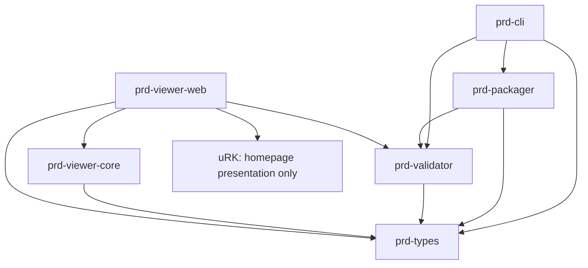

# PRD architecture assessment and modernization plan

_Date: October 26, 2026_
_Status: Source-verified assessment; proposed changes are not ratified format decisions_

## 1. Recommendation and audit boundary

Retain the TypeScript/pnpm monorepo and its six implementation surfaces. PRD already has a working manifest-first, structured, profile-based pipeline. Correct conformance gaps, harden untrusted package opening, align the content schema, and measure rendering before choosing optimizations. A replacement engine or universal replacement content tree would add migration risk without addressing the demonstrated defects.

“PRD 2.0” is a planning label in the supplied proposal. This assessment changes no format/npm versions, product names, accepted decisions, or public APIs. `general-document`, `comic`, and `storyboard` remain the canonical families. Document kinds stay inside those families. PRDc remains the Document Archive Codex ecosystem role.

### Verified source

| Item | Evidence |
| --- | --- |
| Repository | `https://github.com/eonhive/PRD` |
| Freshly fetched `origin/main` | `53314f4dcd6c7e327406ef633710c03dcd980a6e` |
| Local branch / HEAD | `thehive/prd-package-handoff` / `dcb6041bcf85840561c6ea83a7907694fdff8079` |
| Source equality before this audit | Both commits have tree `b065971c74ff6f8e4337ee4dd29f6b07c085c8ff`; `git diff HEAD origin/main` is empty. Main contains the squash merge of the local work. |
| Working tree at start | Clean; no checkout, reset, or branch switch required |
| Execution environment | Apple M1, arm64 macOS; Node `24.5.0`, pnpm `10.32.1` |
| Git environment | Used bundled Git. System Git is blocked by an unaccepted Xcode license; no license or system settings changed. |

Reviewed local instructions, README, build status/backlog, foundation, decisions, glossary, roadmap, history, blueprint, system architecture, profile registry, core/profile/runtime/product contracts, schemas, package boundaries, app open/render paths, examples, scripts, Changesets and all four CI workflows. Archived proposals remain historical context. Current source supersedes the supplied proposal's older implementation inventory.

This is an implementation audit with bounded executable probes, not exhaustive ZIP fuzzing, accessibility certification, or production launch acceptance. The new harness is developer tooling; application and library behavior remains unchanged.

## 2. Executed validation

| Command / check | Result |
| --- | --- |
| `pnpm install --frozen-lockfile` | Passed; lockfile unchanged. pnpm reported ignored dependency build scripts for `esbuild@0.28.2` and `workerd`; no approval settings changed. |
| `pnpm foundation:gate` | Passed: workspace build, **273 tests across 28 files**, root-inclusive docs consistency, five canonical example validations, four aggregate example smoke flows. |
| `pnpm typecheck` | Passed separately; foundation gate does not run the root typecheck command. |
| `pnpm runtime:conformance` | Passed, all five published runtime fixtures. |
| `node scripts/release-smoke.mjs` | Passed: four packed public packages installed and exercised in clean temporary consumers. No publication performed. |
| Audit harness | Eight validator-valid fixtures measured in isolated Node children; bounded probes reproduced the findings below. |
| Desktop browser | Real file chooser opened canonical/synthetic archives in the existing Viewer; measured render checkpoint and outline response; verified the final section target in the DOM. |

No existing test failed. Green tests establish covered behavior; they do not disprove the uncovered gaps. Vitest uses a Node environment. Several web tests assert source/markup, which does not substitute for browser layout or assistive-technology testing.

Not rerun: authenticated release preflight, npm publication, live registry consumer audit, deployment, physical touch/mobile, screen readers, browser/GPU memory profiling, or cold-storage/network benchmarks. There is no root lint script. Existing launch and authoring-release items remain open.

## 3. Current architecture inventory

Links identify audited source; paths are repository-relative.

| Surface | Implemented and evidenced | Boundary / remaining gap |
| --- | --- | --- |
| [`prd-types`](../../packages/prd-types/src/index.ts) | Manifest, three distinct structured roots, resources/attachments, locale overlays, section references, profile normalization, `PrdPackageReader`, opened-document types, runtime vocabulary | Shared contracts. Legacy `responsive-document` normalizes; bare `resume` stays deprecated rather than becoming a canonical family. |
| [`prd-validator`](../../packages/prd-validator/src/index.ts) | Handwritten semantic validation, stable issues, resource existence, links/media/tables/charts, segmentation, localization, three profiles, legacy/custom reporting | Does not execute `schemas/content.schema.json`. Browser-safe file-map API is separate from Node I/O. |
| [`prd-validator/node`](../../packages/prd-validator/src/node.ts) | Directory/archive validation and inspection; eager reads and synchronous unzip | No archive budget or member-wide path screening before decompression. |
| [`prd-packager`](../../packages/prd-packager/src/index.ts) | Validates directories; builds `.prd` ZIP buffers/files | Reads directory once for validation, then again for packing. No fixed ZIP timestamp or reproducible-byte contract. |
| [`prd-cli`](../../packages/prd-cli/src/index.ts) | `init`, Markdown/image import, validate, inspect, pack; unit and built-binary E2E coverage | Authoring exists in source. Three CLI minor Changesets are queued; this audit does not claim those commands shipped to npm. `.prd` packaging is implemented export; PDF/HTML/EPUB conversion is deferred. |
| [`prd-viewer-core`](../../packages/prd-viewer-core/src/index.ts) | Manifest/root parsing, profile normalization, structured roots, HTML safe-mode/unsupported states, common render-mode classification | Parser/dispatcher rather than a complete interpreter. Required declarations and version compatibility are not evaluated. Caller currently supplies validation. |
| [`prd-viewer-web`](../../apps/prd-viewer-web/src/App.tsx) | Validate-before-open; semantic React/CSS, section expansion, locale overlays/alternate entries, Blob URLs, outline, metadata, attachments; keyboard/swipe comic navigation and storyboard review grid | Eager unzip, asset URL creation and all-locale preparation. General documents mount all nodes. Substantial pure interpretation remains in `App.tsx`. |
| [Living Homepage](../product/PRD_LIVING_HOMEPAGE.md) | Six chapters, shared illustrative document, actual embedded Viewer, sample inspection/download handoff, preferences, opt-in audio | App presentation, not a packaged experience contract. uRK vendor snapshots are private web-app dependencies only. Runtime/audio imports are demand-driven. |
| [Schemas / fixtures](../../schemas) | Manifest schema tests, content schema, five canonical examples, invalid profile fixtures, five runtime fixtures | Content schema lags executable content. Unsupported runtime fixture tests an unsupported entry, not a real unknown required declaration. Aggregate smoke omits the segmented example, though validation includes it. |

The supplied proposal understates current implementation: panel selection, storyboard review, structured media, locale resources, segmentation, imports and an app-level uRK experience already exist. Timed storyboards, panel geometry, declared RTL panel sequencing, pagination, saved progress, semantic search, persistent offline library, synchronized narration and packaged interactive scenes were not found in the audited reading path. Locale text direction is not a comic sequence contract.

## 4. Ownership and dependency map

Arrows mean “depends on”; this is the current package graph.



The four public packages are types, validator, packager and CLI, at repository version `0.1.1`. Viewer-core/web are private npm surfaces. `fflate` belongs to validator/packager/web; React/Vite to web; AJV is development schema tooling. No new dependency is needed for the first fix.

### Proposed four-stage organization

| Logical stage | Existing owner | Proposed work after focused fixes |
| --- | --- | --- |
| Package Reader | Node adapter; web `handleFile`/`createPackageReader`; packager | Share browser-safe archive policy/member checks through the validator boundary. Keep filesystem operations in `/node`. Preserve eager small-package loading. |
| Semantic Interpreter | Validator, viewer-core, section/locale helpers in `App.tsx` | Validator owns validity; viewer-core owns truthful negotiation and resolved reading semantics. Move pure resolution after parity tests establish section-then-locale order. Keep Blob lifecycle/presentation in web. |
| Adaptive Presentation | Existing profile components and CSS | One effective content selection through native HTML/CSS; user typography, contrast, reduced motion and future mode preferences preserve semantic order. |
| Optional Experience Runtime | Homepage runtime; future declared package integration | Keep uRK dynamically loaded at app level. Packaged integration requires explicit capability/version/fallback/lifecycle contracts first. |

“One document model” should mean shared manifest/resource/identity contracts, explicit profile roots and one resolved interpretation path. It should not flatten panels/frames into general-document nodes or replace public wire shapes. No new engine package, parallel renderer, universal plugin framework, custom text-layout engine or permanent frame loop is justified.

## 5. Findings and security assessment

Raw probe evidence is in the [Node snapshot](baselines/2026-10-26-node.json).

| ID / priority | Classification and evidence | Consequence / proposed correction |
| --- | --- | --- |
| A01 / P1 | **Verified runtime defect.** Required-capability `string[]` and `{required: [...]}` containing `audit.unsupported`, and an array extension with `required: true`, validate and open as `fully-supported`. Viewer-core never compares declarations. | Conflicts with [capability negotiation](../runtime/PRD_CAPABILITY_MODEL.md). Preserve validity; return `unsupported-required-capability` when required behavior cannot be honored. Capability guard first; extension handling as a distinct follow-up. |
| A02 / P1 | **Verified acceptance gap and resource-exhaustion exposure.** Archives with unreferenced `../outside.txt`, `/absolute.txt` and `assets\backslash.txt` members validate. An 8,754-byte archive with an 8 MiB zero member validates. Both open paths call `unzipSync` before limits. | No disk extraction occurs; filesystem overwrite was **not** demonstrated. Screen all member names/collisions and enforce configurable archive/member/count/expanded-byte budgets. Claimed ZIP lengths alone are insufficient; bound actual decoding too. Runtime limits must remain distinct from format identity. |
| A03 / P1 | **Verified interoperability defect.** Document Basic and Segmented Document pass the executable validator but fail distributed content schema; Resume Basic passes both. | Schema lacks links/table/chart/media, optional IDs and `section.src`. Align with accepted profile/segmentation contracts and add positive/negative parity tests. Do not narrow valid authored content to fit stale schema. |
| A04 / P2 | **Verified behavior, unresolved policy.** Format/manifest versions and `minViewer` set to `999.0` still validate/open fully supported. | Checks cover non-empty strings, not supported ranges. [Versioning policy](../core/PRD_VERSIONING_POLICY.md) leaves future compatibility/migration open. Decide warning/rejection/migration behavior before changing acceptance; preserve `1.0` and legacy behavior. |
| A05 / P2 | **Source-backed fallback isolation gap; exploit not demonstrated.** HTML rewriting retains arbitrary markup/CSS and unresolved remote URLs, then renders `srcDoc` with `sandbox=""`. | Sandbox restricts script/origin privileges, but is not sanitization or network denial. Specify/test resource/navigation policy, restrictive CSP, allowed markup/CSS and attachment behavior. Script execution or data exfiltration was not demonstrated. |
| A06 / P2 | **Verified reproducibility gap.** Packing unchanged source twice across a ZIP timestamp boundary produces different SHA-256 values. | Normalize timestamps/order before promising reproducible package identity. Not a current format-validity violation. Preserve public signatures unless an additive option is justified. |
| A07 / P2 | **Measured rendering concern.** Long fixture mounts 12,167 elements; development render checkpoint 295–764 ms versus 43–67 ms for small document. | Reproduce in production, then compare native containment/content visibility and inactive-locale preparation before virtualization. Node parsing is not browser rendering. |
| A08 / P2 | **Source-backed maintenance concern.** App has 3,256 lines; validator index 4,591. Directory collection is duplicated; packager reads twice. Pure interpretation is distributed across validator/app/inspection. | Extract focused helpers behind existing exports when changing those areas. No broad framework/file split first. Duplicate I/O cost was not separately timed. |
| A09 / P2 | **Coverage/release-policy gaps.** Runtime conformance is absent from foundation/default CI/release checks. Root engine >=22 conflicts with Codex CI Node 20. CLI-only minor Changesets meet preflight's unified-public-version requirement. | Add declared-capability fixtures/gate wiring; reconcile contributor versus public package Node floors. Preserve backlog item 46's separate release task; do not casually bump unrelated packages. |

### Existing controls and unverified surfaces

- Entry/declared resource references reject unsafe paths. Core external assets and `javascript:` structured links fail bounded probes. HTTP(S) linked attachments remain supplemental.
- Web validates before calling viewer-core. Ordinary structured content uses React text/semantic elements; no package-script evaluator was found there. Sandboxed HTML fallback needs further resource-policy tests.
- Object URLs are revoked on replacement/unmount. Asset bytes are copied into Blob backing storage; this is an allocation path, not a demonstrated leak.
- Base local package processing requires no accounts, AI, server, PRDc, wallets or uRK. An HTTP-hosted shell is distinct from a persistent offline library/installable offline app.

Still unverified: duplicate ZIP members/canonicalization, corrupt size headers/CRC, parser recursion/node-count limits, MIME/SVG/HTML attachments, fallback network requests, and file replacement races between validation and packing. Add bounded hostile fixtures before claiming these closed. Never use unbounded decompression probes on developer machines.

## 6. Performance baseline and optimization proposals

```sh
pnpm build
node scripts/architecture-baseline.mjs --browser-fixtures
pnpm dev:web --host 127.0.0.1 --port 5179
```

Default output: `examples/dist/architecture-baseline.json`. The checked-in [Node snapshot](baselines/2026-10-26-node.json) used `--out docs/architecture/baselines/2026-10-26-node.json`. Five canonical and three synthetic fixtures are validated; fixture ZIP timestamps are fixed. Node temp probes are cleaned. Browser fixtures/harness remain ignored under `apps/prd-viewer-web/public/examples/architecture-audit/`.

### Node

One warmup plus five samples per fixture/strategy in fresh child processes, forced GC before samples, warm filesystem cache. Open total includes read/unzip/validate/viewer-core root parse. It excludes app section expansion, locale overlays, Blobs, image decoding, DOM/layout/paint. Column medians are independent and need not sum exactly. RSS is lifetime child-process high-water including imports/warmup, not incremental document memory.

| Fixture | Archive | Median unzip | Median validation | Median root parse | Median total | Peak RSS |
| --- | ---: | ---: | ---: | ---: | ---: | ---: |
| Document Basic | 5.52 KiB | 0.751 ms | 0.225 ms | 0.028 ms | 1.522 ms | 61.3 MiB |
| Segmented Document | 2.51 KiB | 0.295 ms | 0.128 ms | 0.017 ms | 0.796 ms | 60.5 MiB |
| Resume Basic | 2.34 KiB | 0.298 ms | 0.187 ms | 0.026 ms | 0.901 ms | 61.1 MiB |
| Comic Basic | 594.2 KiB | 2.200 ms | 0.165 ms | 0.022 ms | 4.322 ms | 66.1 MiB |
| Storyboard Basic | 2.80 KiB | 0.316 ms | 0.099 ms | 0.016 ms | 0.759 ms | 60.5 MiB |
| 1,000 sections / 5,000 paragraphs | 40.3 KiB | 3.782 ms | 7.066 ms | 2.566 ms | 14.698 ms | 102.6 MiB |
| Eight 4 MiB binary assets | 32.01 MiB | 3.488 ms | 0.128 ms | 0.035 ms | 12.690 ms | 220.8 MiB |
| Four 4096×4096 PNG panels | 394.4 KiB | 16.381 ms | 0.129 ms | 0.021 ms | 17.032 ms | 86.6 MiB |

**Selective materialization probe:** retain the compressed archive but inflate only manifest/content members. For 32 MiB assets, this materializes 960 rather than 33,555,392 bytes, with unzip median 0.282 ms and peak RSS 156.4 MiB. Large-PNG unzip falls from 16.381 to 0.126 ms. The probe **skips validation and assets**, so its total is not an equivalent validated open. It does not resolve sections, lazily decode images, or implement range requests. This supports an investigation, not a production loader or browser-memory-saving claim.

### Browser

Open `http://127.0.0.1:5179/examples/architecture-audit/index.html`. The harness boots the actual Viewer with a visible metric panel. Choose generated archives through the native chooser. It observes input `change` to two frames after ready document DOM commit, then decodes stage images. It does not invoke app handlers or inspect React state. Capture the panel JSON to reproduce the [browser snapshot](baselines/2026-10-26-browser.json).

After capture, remove the generated `apps/prd-viewer-web/public/examples/architecture-audit/` directory before a demo build so synthetic stress packages are not copied into deployment output. This audit removed its generated browser fixtures after verification.

Desktop in-app Chromium 156, 1280×720, Vite development/React StrictMode. Repeated opens share one session, with no cache reset/throttling. This checkpoint is **not** first raster/FCP, smooth-scroll completion, a production SLA or peak browser memory.

| Fixture | Opens | Median checkpoint | Range | Image decode checkpoint |
| --- | ---: | ---: | ---: | ---: |
| Document Basic | 3 | 47.5 ms | 42.6–66.8 ms | median 47.8 ms |
| 1,000 sections | 4 | 533.7 ms | 294.6–764.1 ms | no images |
| Four 4096×4096 panels | 3 | 82.8 ms | 70.6–377.7 ms | active image median 188.1 ms |
| 32 MiB assets | 1 | 125.4 ms | single observation | no images |
| Comic Basic | 1 | 59.0 ms | single observation | 61.4 ms |
| Storyboard Basic | 1 | 40.5 ms | single observation | four rendered image elements: 250.6 ms |
| Segmented Document | 1 | 38.6 ms | single observation | no images |

Five long-document outline clicks reached two frames in 18.4–80.8 ms (median 69.7 ms). Final target was verified 105 px below viewport top; all 1,000 sections stayed mounted. The image fixture exposes one guided panel at a time, so decoding covers the active image, not four simultaneous images. One 4096² RGBA bitmap represents 64 MiB of pixels mathematically; actual browser/GPU allocations were not profiled.

**Optimization order:** capture production desktop/mobile traces; compare native long-document containment and deferred inactive-locale preparation; measure on-demand Blob URLs/decoding; consider workers only if main-thread stalls justify them. Preserve order, anchors, find-in-page, selection, accessibility and print in any containment/virtualization trial. Keep eager small-package loading. No new loading system/dependency is introduced here.

## 7. Future capability evaluation

| Capability | Existing baseline | Proposed next step / priority |
| --- | --- | --- |
| Adaptive reading / responsive comparison | Responsive CSS; homepage device views are illustrative | User typography/contrast and actual renderer previews. Print/pagination remains separate unfinished work. High. |
| Guided comics | Ordered controls, keyboard and pointer swipe | Preserve array sequence; define RTL/geometry before wire fields. Optional zoom/transitions. High. |
| Storyboard sequence | Frames, notes, active review grid | Duration/dialogue/timed playback require profile evolution and static board fallback. High after fixes. |
| Accessibility transforms | Semantic content, alt text, keyboard, reduced motion/theme | Screen-reader/physical-touch validation and user overrides. High. |
| Progress / semantic search | Stable IDs and outline; no persistence/search found | Viewer-owned structural position per revision/locale; index resolved semantics. Medium. |
| Offline library / caching | Local processing once shell is available | Viewer storage/service-worker lifecycle and quotas, separate from validity. Medium. |
| Content-addressed resources | Resource declarations; no shared hash contract | Deterministic bytes first; optional integrity/dedup contract preserving references. Medium. |
| Narration synchronization | Packaged media, optional app audio | Stable range/locale mapping with accessible fallback. Later. |
| Interactive media / uRK | Optional homepage runtime only | One declared experience with activation, capability, version, resource and disposal rules. Later. |
| AI / revision comparison | No implementation found in current pipeline | Optional transformations preserve originals; semantic revision comparison separately scoped. Later. |

“PRD Reader” and “PRD Experiences” remain proposed positioning, not accepted product tiers or parallel renderers. The existing Viewer can host optional modes while keeping static readability independent. Do not rename code/canon in this audit.

## 8. Phased roadmap and acceptance criteria

These follow-up audit phases do not renumber the canonical roadmap.

| Phase | Small reviewable work | Acceptance criteria |
| --- | --- | --- |
| Audit baseline (this change) | Inventory, reproducible probes, measurements, decision proposals | Source/scope explicit; gates executed; facts/proposals separated; unsupported measurements disclosed. Production/mobile/memory follow-up remains open. |
| 1. Foundation corrections | Capability guard, required extensions, archive policy, schema parity, version policy in separate slices | Unknown required behavior never reports fully supported; optional additions preserve base readability. Hostile members/budgets reject before unsafe consumption. Profiles/legacy support preserved. Schema covers accepted nodes/invalid variants. Compatible published changes use Changesets. |
| 2. Interpretation / measured loading | Pure section/locale resolution behind existing contracts; remove repeat reads where touched; compare loading/render options | Section resolution precedes overlays; IDs/order match across consumers. Production/constrained-device measurements demonstrate improvement without small-package or anchor/search/keyboard/locale/accessibility regressions. Set measured budgets before adopting workers/virtualization. |
| 3. Reading quality | User preferences, polished visual modes; RTL/timing only after profile decisions | Same semantics/order across modes; mobile/keyboard/screen-reader checks; user overrides/reduced motion work. New wire behavior has version policy, docs, positive/negative fixtures and fallback. |
| 4. One packaged experience | Optional audio/motion/interactive scene | Valid/readable offline without uRK/AI/accounts. Missing optional behavior degrades truthfully; required behavior blocks truthfully. No work after hiding/disposal; explicit resource/network policy. |
| 5. Creation / distribution | Resolve queued CLI release policy; focused import/export/library improvements | Clean npm consumer verifies released commands; release gates pass; export losses documented. Studio, broad conversion, Cloud and PRDc stay separate. |

Preserve launch items 44/48 and authoring release item 46 in `NEXT_STEPS.md`. An architecture audit does not complete deployment or physical-device acceptance.

## 9. Proposed decision records

The canonical ledger records these as **pending**, with this assessment as evidence:

- **PRD-P009:** Four logical stages within existing packages; preserve three wire roots and one interpretation path. A new engine/universal AST rewrite has no demonstrated need. Acceptance needs a narrow implementation slice and compatibility tests.
- **PRD-P010:** Configurable archive/resource budgets and fallback resource isolation at implementation boundaries. Alternatives are unbounded decode or undocumented format-wide limits. Numeric defaults, error contracts and actual malformed-archive limits remain undecided.
- **PRD-P011:** Optional packaged-experience seam; uRK is one possible on-demand app runtime. Require static fallback and lifecycle/capability/version contracts. Current homepage stays app-only. No product rename, manifest field, mandatory runtime or blanket script permission is accepted.

Accepted decisions PRD-026–038 continue to apply. A01/A03 correct existing contracts; A04/P010/P011 need policy decisions rather than silent format tightening.

## 10. Exact first implementation task

**Title:** Report unsupported required capabilities before opening structured content.

**Problem:** A validator-valid package requiring `audit.unsupported` receives `fully-supported` from `openPrdDocument`, including the legacy capability array. Existing unsupported fixture only uses an unsupported entry extension.

**Planned files:** `packages/prd-viewer-core/src/index.ts`, existing unit/runtime tests, two small fixtures under `examples/runtime-conformance/fixtures/`, runtime conformance manifest, `docs/runtime/PRD_CAPABILITY_MODEL.md`, `docs/runtime/PRD_CONFORMANCE.md`, `BUILD_STATUS.md`, `NEXT_STEPS.md`.

1. Read required capabilities from both accepted declaration forms after manifest/profile normalization.
2. Compare with `PRD_REFERENCE_VIEWER_SUPPORTED_CAPABILITIES`. Return the existing `unsupported-required-capability` state and a clear message before root parsing for unsupported requirements. Preserve normalized manifest/profile/entry facts without a fully supported render payload. Do not invent fallback declarations.
3. Keep validity unchanged. Supported requirements, missing declarations and optional unknown capabilities retain behavior. Do not invent mandatory comic/storyboard capability IDs.
4. Test both forms, supported/optional cases, and a reader spy proving unsupported content is not parsed. Add validator-valid runtime fixtures expecting unsupported state/render mode. Keep alias and HTML safe-mode tests green.
5. Run focused viewer-core tests, cross-package render-mode integration, typecheck, runtime conformance and foundation gate. Review CI gate wiring as a separate step if scope warrants.

This changes private viewer-core behavior while preserving signatures, public npm exports and CLI JSON contracts. No new dependency/public npm Changeset is needed if those surfaces stay unchanged. Required extensions are the next distinct fix; archive safety/schema alignment remain high priority. This assessment identifies the task; it does not implement it.

### Implementation follow-up — October 27, 2026

The first task is now implemented: viewer-core checks object/legacy-array required capabilities before reading the entry, preserves validity and normalized opening facts, and reports unsupported requirements without a render payload. The web app also stops preparation of localized alternate entries for this state. Unit/integration tests and two validator-valid runtime fixtures cover the change. Required extensions, archive hardening, schema parity and version policy remain open. The audit findings and raw snapshots above describe the October 26 source revision and are preserved as historical evidence.

The subsequent [container slice](../core/PRD_CONTAINER_FORMAT.md) adds an opt-in PRD 1.0 header and a shared bounded decoder for both transports. It implements archive member/path/count and declared/actual byte guards from A02 while retaining ZIP default output. A02's deeper CRC/integrity/fuzzing and fallback isolation concerns are not claimed closed. October 26 measurements intentionally remain evidence for the original code, not the new decoder.

The owner's next requested phase adds optional [signature-v1](../extensions/PRD_SIGNATURE_V1.md) under PRD-041. It covers exact logical file bytes and the complete file set with SHA-256/Ed25519, excludes its own metadata and transport encoding, and requires an independently trusted public key for verified status. CLI commands and web-host checks reuse existing packages. This supplies signed-content integrity without closing unsigned ZIP CRC, deterministic archive bytes, advanced trust infrastructure, required-extension negotiation or fallback-isolation work. The original measurements and findings remain historical evidence.

The subsequent required-extension correction now checks explicit array-form `required: true` declarations before profile dispatch/content reads. Viewer-core has no required extension handlers and returns the existing unsupported state with named IDs, retaining manifest/locale facts. Optional declarations and object placeholders remain compatible. Two additional validator-valid runtime fixtures cover blocked required and readable optional behavior; a host integration test confirms valid optional signing cannot bypass the guard. Required-extension enforcement is complete for this unsupported baseline. Implemented handlers, version negotiation and fallback contracts remain separate future work; the earlier audit findings above remain historical evidence.

The subsequent content-schema alignment resolves A03's identified canonical-shape gaps: all existing general-document node types, optional IDs and top-level segmented references are represented, and section files have a reusable schema fragment. Real example roots/sections and structural negative cases are tested against both schema and semantic validation. Package-level relationships remain explicit semantic checks. Parity work also reproduced and corrected the validator's malformed `src` plus non-array `children` loophole without changing valid section forms. A04 remains unresolved policy: version/minimum-viewer strings are not silently narrowed by the schema change, and the versioning policy now records the precise current checks and decision requirements. Historical source measurements/findings above remain unchanged.

### Version compatibility follow-up — October 28, 2026

PRD-046 resolves A04 for the reference opening path: exact `1.0` / `1.0.0` contracts and numeric two/three-component minimum-viewer comparison now run independently of structural validity. Manifest requirements stop before entry reads; default roots, referenced sections and declared localized alternates pass version metadata checks before any render payload is returned. The existing unsupported state/host guard prevents locale/media preparation, and optional signing cannot bypass compatibility. Current `1.0` examples and documented legacy/alias fallback paths are preserved. Seven new conformance packages exercise supported, future, newer-minimum, malformed-minimum, section and localized cases. General ranges, older decoders, migration and per-locale substitution remain outside this accepted baseline. The October 26 measurements and original findings remain historical evidence.

### Directory loading follow-up — October 28, 2026

PRD-049 closes the unbounded unpacked-directory loading gap through one shared validator Node reader used by validation, inspection and packaging. Defaults match archive per-file/total/count policies; all visited entries count toward traversal, with hidden subtrees and non-regular entries still excluded from contents. Metadata checks precede data reads and actual-byte checks precede chunk retention, covering growth after stat. Library overrides, coded errors, null-prototype maps and failure-before-output behavior are tested. Generic Node limits forward to directories or archives as appropriate. Direct directory I/O failures now produce invalid results through the existing issue structure.

This changes no format size maxima, binary header, public JSON fields or eager-loading claim. The collected bytes still occupy memory, filesystem reads are not an atomic snapshot, and source-tree stability remains required. ZIP integrity/malformed-archive coverage and HTML fallback resource/navigation isolation remain open under PRD-P010. Historical performance measurements are retained without claiming a measured speed or peak-memory improvement from this change.

### ZIP integrity follow-up — October 28, 2026

PRD-050 addresses the unsigned-member CRC and bounded record-consistency part of A02. Seven failing probes first reproduced accepted stored-byte corruption, forged/mismatched CRC metadata, a wrong central extent and ignored encryption flags. The reader now checks end/central/local/descriptor bounds, names, flags, sizes and physical ranges before passing indexed slices to the existing fflate inflater. Every member's actual decoded bytes must match CRC-32 before the file map is returned. Streaming descriptor variants and safe single-disk ZIP64 stay supported without marker scanning inside stored data. Existing budgets, transports, semantic/public JSON contracts and optional signature verification remain separate.

Regression coverage includes independent CRC vectors, multi-chunk data, descriptor-marker ambiguity, comments/extra fields, reordered directories, malformed/unsafe wide fields, overlap/unlisted data, bounded bit mutations/truncation, Node/CLI rejection/recovery and installed consumers. Eight Python-generated seekable/streamed stored/DEFLATE/forced-ZIP64 variants pass both transports. Ignored `examples/dist/zip-integrity-qa/` contains compatibility evidence and checked valid/corrupt PRD archives for follow-up. Live browser access was disabled in Work settings; its checksum rejection/resource cleanup/recovery acceptance is explicitly pending.

This closes neither exhaustive hostile-input/fuzz assurance nor HTML fallback resource/navigation isolation. CRC is not publisher authentication or whole-archive metadata coverage. Historical baselines stay unchanged; no CPU/peak-memory improvement or independent security audit is claimed. PRD-P010/item 54 remain open for those remaining checks and the next HTML isolation increment.

### HTML fallback containment follow-up — October 29, 2026

PRD-051 addresses A05's permissive HTML preparation through the private Web Viewer. The previous DOMParser/rewrite path retained unresolved URLs, authored styles and navigation; detached browser parsing could also initiate resource requests before rewriting. A bounded, dynamically imported parse5 data-tree compiler now emits escaped reading elements and selected declared package-local raster/native media. It rebuilds the head with an early default-deny CSP, permits only the fixed stylesheet hash and selected Blob media, and uses an opaque sandboxed frame with explicit referrer/permission restrictions. Authored links, forms, CSS, SVG/foreign content and nested documents are unavailable in this restricted preview. See the [reference fallback policy](../runtime/PRD_HTML_FALLBACK_POLICY.md).

Source review also found per-field locale fallback could retain base HTML alongside structured alternate content. Whole-presentation selection now replaces all render fields together. Current localized alternate validity remains JSON-only; defensive HTML-alternate preparation is contained without becoming a newly supported format path. Package URL staging handles async preparation failure/stale replacement/unmount, approved resources are shared only within a package, and automatic host cover/Files images are suppressed while HTML is active. Original package bytes, signature coverage, public APIs and structured rendering remain unchanged.

The real hostile HTML/structured-locale fixture validates and prepares through both transports. Sixty-eight added cases cover paths, markup/escaping, CSP/hash, resource declarations/types/budgets, allocation rollback, safe-mode/frame behavior and locale replacement. At this increment's foundation run, 980 tests across 52 files, build/docs/examples/aggregate smoke, root typecheck and 16 runtime fixtures passed; totals include independent shared-checkout work. Root and `/prd/` builds confirm parse5 remains a separate lazy chunk. Ignored Node-only preparation evidence under `examples/dist/html-fallback-isolation/` uses synthetic Blob URLs and is not a browser render.

Browser use was disabled in Work settings. Live request/navigation denial, media playback, replacement/disposal, accessibility and cross-engine acceptance remain pending under PRD-P010/item 54. Header screening is not full media validation, the reference budgets are not exact heap/CPU limits, and this is not an independent sanitizer audit. Historical performance baselines remain unchanged. Production/constrained-device traces and archive reprofiling still precede workers, virtualization or default transport migration.

### Bounded-loader profiling follow-up — October 29, 2026

The [current loader baseline](../core/PRD_PERFORMANCE_AND_LOADING.md#13-current-loader-measurements-and-stored-windows-october-29-2026) now measures `readPrdArchive`, including record/path/budget checks, CRC and complete file materialization, rather than the original harness's less restrictive `unzipSync` experiment. Eight reused fixtures × two compression levels × two transports yield 32 cases. Fresh GC-enabled Node children separate read/decode/validation/root interpretation and record lifetime process RSS. Every repetition's complete file digest must match its fixture; reports include archive hashes and built-module fingerprints. Comparison checks reject mismatched fixture/method/environment facts. Original October 26 data remains historical, not an equivalent performance comparison.

A bounded stored-member optimization remains within PRD-050: use 64 KiB source windows after stored sizes are proven equal, retaining the existing receive checks, CRC and final owned buffers. DEFLATE stays at 1 KiB compressed input. For 32 MiB of stored assets, the initial ZIP/envelope medians were 192.468 / 200.957 ms; final medians are 177.419 / 173.954 ms and a stress rerun gives 176.927 / 173.780 ms. Asset window/callback count falls from 32,768 to 512. No default writer, dependency, API/diagnostic or loading contract changes. Boundary/ownership regressions supplement existing checksum, hostile-input and budget coverage; a validator patch Changeset records release intent.

The same report preserves rejected indexed-CRC and single-stored-slice trials. CPU samples show checksum/receive and inflater copying costs, but measurements on an interactive host are not controlled statistical evidence. Unchanged compressed-image controls range from about 140 MiB peak RSS to 261 MiB in the rerun; the indexed trial reached about 283–290 MiB. No causal GC finding, universal speed or memory-saving guarantee follows. Investigate transient DEFLATE allocation separately before changing compressed push size or decoder strategy. App rendering, browser/GPU memory, section/locale/Blob preparation, cold cache and physical-device behavior remain unmeasured by this new tool. Fresh browser inventory still reports local use disabled; items 54/56 and any default-writer/release decision remain open.

### Allocation follow-up — October 30, 2026

The [allocation investigation](../core/PRD_PERFORMANCE_AND_LOADING.md#14-allocation-investigation-and-viewer-blob-preparation-october-30-2026) measured a direct per-member output-buffer trial against a fresh 32-case baseline. Complete logical bytes and existing reader checks passed, but timing gains were inconsistent. A three-byte malformed payload advertising 32 MiB showed 33,718,272 bytes of ArrayBuffer growth in the trial versus 163,840 in the retained reader, with both reporting `archive-read-invalid`. The prototype was reverted. Eight new integrity cases preserve multiple/empty-file ownership, forged-length rejection, aggregate-limit priority and avoidance of advertised-capacity reservation for a short malformed prefix. No decoder/API/limit/writer change remains from that experiment.

Source review identified a separate redundant copy in the private Viewer's Blob preparation. New `assetBlob.ts` passes exact ordinary ArrayBuffer views to native immutable snapshot construction, with copying fallbacks for shared/foreign backing stores. Eight new tests cover bytes, offset/pool/zero-length ranges, snapshots, fallbacks and URL-owner integration. Package/signature bytes, MIME/resource policies and URL cleanup remain unchanged. The Node helper experiment removes 32 MiB of explicit preliminary clones from 32 MiB of fixture assets; construction medians were 3.871 → 2.235 ms, with the rerun at 3.381 → 3.029 ms. These native-Node figures and process memory include setup/verification and do not establish browser rendering or universal peak-memory/latency improvements. Raw reports and the rejected trial remain linked from the performance policy. Live resource/media/disposal and production/device/GPU traces stay open; private-app/test-only changes require no public-package Changeset.
